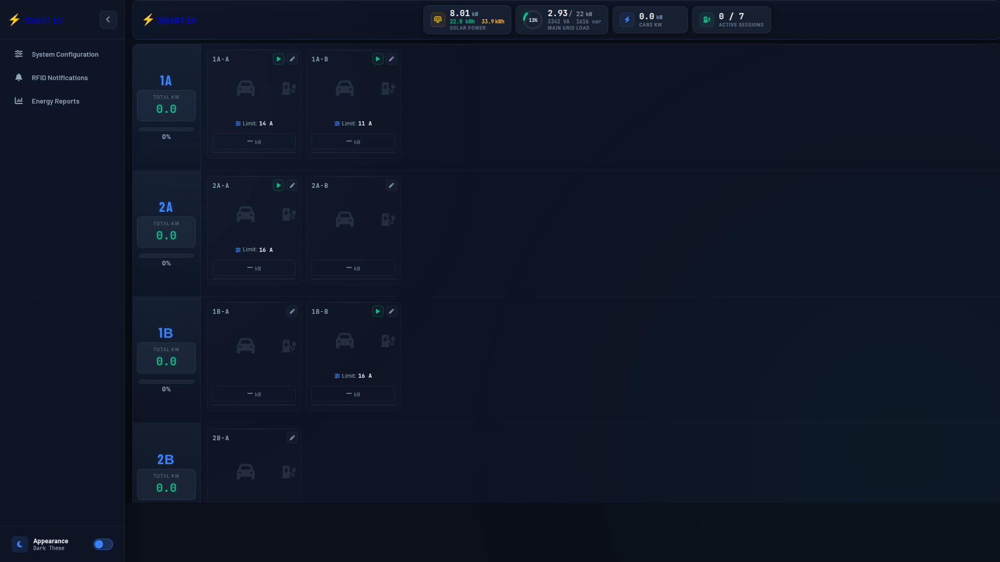
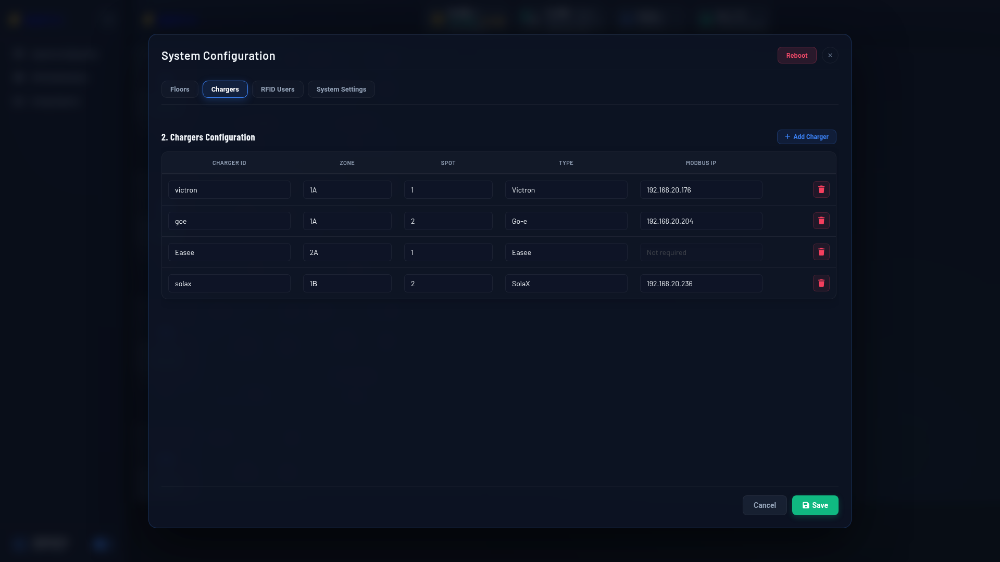
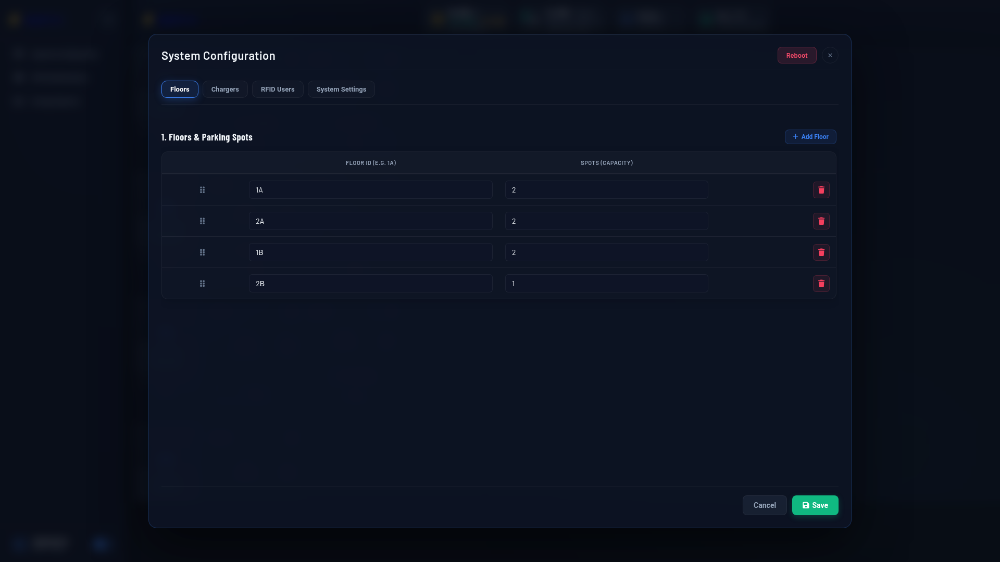
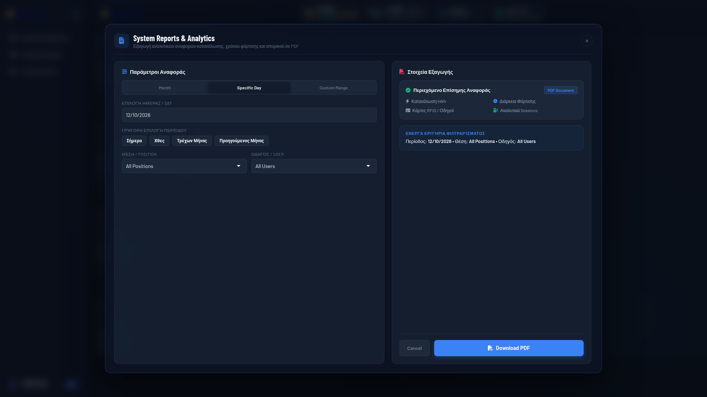
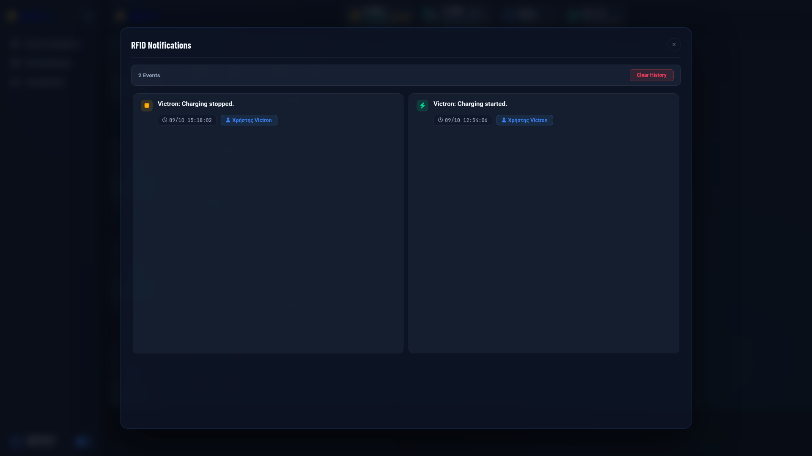
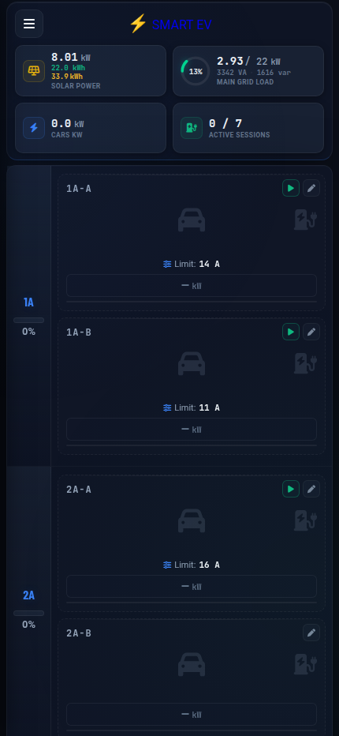
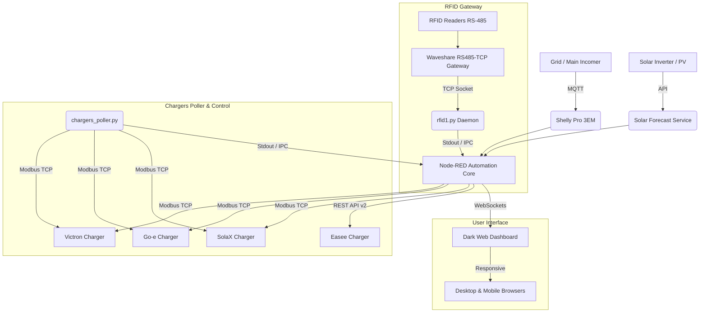

# ⚡ Smart EV Charging & Parking Management Platform

[](https://nodered.org/)
[](https://python.org/)
[](https://modbus.org/)
[](https://mosquitto.org/)
[](https://www.raspberrypi.com/)

A comprehensive, enterprise-grade EV charging orchestration and smart parking automation solution. Designed for commercial, enterprise, and residential multi-charger installations, this platform combines real-time multi-brand charger control, dynamic load balancing, photovoltaic solar forecast optimization, Waveshare RS485 RFID authorization, and a responsive dark-themed dashboard.

---

## 📸 Screenshots

### Live Telemetry & Interactive Parking Grid


### Multi-Brand Charger Configuration & Network Management


### Floors & Parking Spot Capacity Management


### Energy Reports & Export Analytics


### RFID Events & Session Authorization Log


### Mobile View (Responsive Layout)
<p align="center">
  
</p>

---

## 🌟 Key Features

### 🔌 Multi-Brand EV Charger Integration
* **Victron Energy (CCGX / Cerbo GX / EVCS)**:
  * Native Modbus TCP register-level control.
  * Start/Stop single-packet FC16 execution (Register 5009 mode, Register 5010 command).
  * Ultra-fast direct current adjustment (Register 5016, 6A–32A).
  * Lifetime and session energy tracking (Register 5021).
* **Go-e Charger**:
  * Real-time Modbus TCP polling (Input Registers 100 Car State, 120 Power Total).
  * Charging enable/disable control (Holding Register 201).
  * Volatile & EEPROM current limit management (Holding Register 299).
* **SolaX EV Charger**:
  * High-speed Modbus TCP monitoring of voltages, phase currents, active power, and energy meters.
  * Direct FC16 command dispatch for immediate Start, Stop, and Amperage regulation (Registers 1549, 1556, 1572, 1576, 1615, 1598).
* **Easee Wallbox**:
  * Seamless Cloud REST API v2 integration.
  * Dynamic current phase balancing (`phase1`, `phase2`, `phase3`).
  * Circuit-level and charger-level current limits with automatic token renewal.

---

### ⚖️ Dynamic Load Balancing (DLB) & Grid Protection
* **Shelly Pro 3EM Grid Telemetry**: High-frequency MQTT integration monitoring total building power and individual phase loads.
* **Intelligent Power Allocation**: Dynamically caps EV charging amperage when total facility load approaches configured grid capacity (`TOTAL_POWER`).
* **Solar PV Production Prioritization**: Dynamically harnesses solar surplus power to charge vehicles with zero-carbon energy.

---

### ☀️ Photovoltaic Solar Forecast Optimization
* **Automated Solar Yield Prediction**: Python daemon (`solar_forecast.py`) fetches and calculates forecasted solar generation for today and tomorrow.
* **Loss Model Analytics**: Analyzes unshaded potential, shading losses, cloud coverage penalties, and temperature derating.
* **Real-time Forecast Telemetry**: Continuously informs charging algorithms to optimize charging schedules based on peak solar windows.

---

### 💳 Industrial RFID Authorization & Access Control
* **Waveshare RS485-to-Ethernet TCP Gateway Integration**: High-reliability TCP daemon (`rfid1.py`) interfacing with RFID readers.
* **Dual CRC16 Auto-Detection**: Supports both `0x0000` and `0xFFFF` CRC-CCITT protocols automatically.
* **Session Ownership Locking**: Active charging sessions are locked to the authorized card/driver, preventing other users from inadvertently interrupting an ongoing session.
* **Multi-Charger Smart Selection**: When a driver has access to multiple parking spots, a card swipe automatically opens a fast choice dialog on the dashboard.
* **Optical & Acoustic Feedback**: Drives green/red LED states and buzzer confirmation sequences.

---

### 📊 Energy Accounting & PDF Reporting
* **Session Historian**: Tracks timestamped charging sessions including energy delivered (kWh), duration, associated RFID user, and parking zone.
* **Filtering & Data Export**: Filter reports by Month, Day, or Custom Date Range, as well as by specific parking position or driver.
* **Automated PDF Export**: In-browser PDF generation via `html2pdf` with styled tables and summary KPIs.

---

## 🏛️ System Architecture



---

## 📁 Repository Structure

```
Smart-EV/
├── build_deploy.py            # Automated builder that compiles deploy.sh
├── deploy.sh                  # 100% self-contained one-command installer
├── chargers_poller.py         # Multi-threaded Python Modbus poller (Victron, Go-e, SolaX)
├── rfid1.py                   # Python RFID reader daemon with RS485 TCP bridge
├── solar_forecast.py          # Python solar PV forecast engine
├── flows.json                 # Node-RED core flows & automation logic
├── smart parking.html         # Responsive web dashboard UI & template
├── smart-parking-config.json  # Configuration file (floors, chargers, RFID users)
├── cars-config.json           # Vehicle profile and UI badge assignments
├── solar-forecast.json        # Solar forecast output cache
├── influxdb_queries_manual.md # InfluxDB metrics guide
├── docs/
│   └── screenshots/           # UI screenshots
└── .gitignore                 # Clean repository filter rules
```

---

## 🚀 Installation & Deployment

### Quick Setup on a Fresh Raspberry Pi / Linux Server

This project includes a **100% self-contained deployment script** (`deploy.sh`) that embeds all dependencies, configurations, and flows.

#### 1. Transfer `deploy.sh` to your target machine:
```bash
scp deploy.sh user@raspberrypi.local:~/
```

#### 2. Run the installer with `sudo`:
```bash
chmod +x deploy.sh
sudo ./deploy.sh
```

#### 3. Unattended / Automated Mode:
To install without interactive prompts (uses default user `smartev` and standard credentials):
```bash
sudo ./deploy.sh -y
```

### What `deploy.sh` automates:
1. **System Packages**: Installs `curl`, `nodejs`, `npm`, `mosquitto`, `python3-pip`, `pymodbus`, `iptables`, `iptables-persistent`.
2. **Node-RED**: Installs official Node-RED and sets up systemd background service.
3. **Contrib Packages**: Installs `node-red-dashboard`, `node-red-contrib-modbus`, `node-red-contrib-influxdb`, and `bcryptjs`.
4. **Instant Dark Splash Screen**: Patches dashboard loader to prevent white blank flashes on load.
5. **Secure Configuration (`settings.js`)**:
   - Enables `localfilesystem` context storage for persistence.
   - Configures global context (`os`, `fs`, `path`, `child_process`, `net`).
   - Secures editor and dashboard with bcrypt admin credentials.
6. **Code & Daemon Unpacking**: Extracts all Python daemons and configs to target user directories.
7. **Network Bridge**: Configures static IP `192.168.0.1/24` on `eth0` with iptables NAT masquerade to `wlan0`.
8. **Service Activation**: Starts Mosquitto broker and Node-RED services.

---

## ⚙️ Configuration

### `smart-parking-config.json`
Manages parking zones, charger mappings, user permissions, and power limits:
```json
{
  "FLOORS": [
    { "id": "1A", "cars": 2 },
    { "id": "2A", "cars": 2 },
    { "id": "1B", "cars": 2 },
    { "id": "2B", "cars": 1 }
  ],
  "CHARGERS": {
    "victron": { "zone": "1A", "spot": 1, "type": "victron", "ip": "192.168.20.176" },
    "goe":     { "zone": "1A", "spot": 2, "type": "goe",     "ip": "192.168.20.204" },
    "Easee":   { "zone": "2A", "spot": 1, "type": "easee",   "ip": "" },
    "solax":   { "zone": "1B", "spot": 2, "type": "solax",   "ip": "192.168.20.236" }
  },
  "USERS": {
    "5A61CA0003": {
      "name": "Alex Smith",
      "charger": "victron, solax",
      "pin": "1234",
      "isAdmin": false
    }
  },
  "TOTAL_POWER": 20,
  "maxPower": 20
}
```

---

## 🔒 Security Notice

All sensitive third-party API credentials in `flows.json` (such as Easee Cloud authentication) have been parameterized with placeholders:
* **Username:** `YOUR_EASEE_USERNAME`
* **Password:** `YOUR_EASEE_PASSWORD`

Update these values via the Node-RED UI editor or configuration nodes after deployment.

---

## 📄 License

This project is licensed under the [MIT License](LICENSE).
